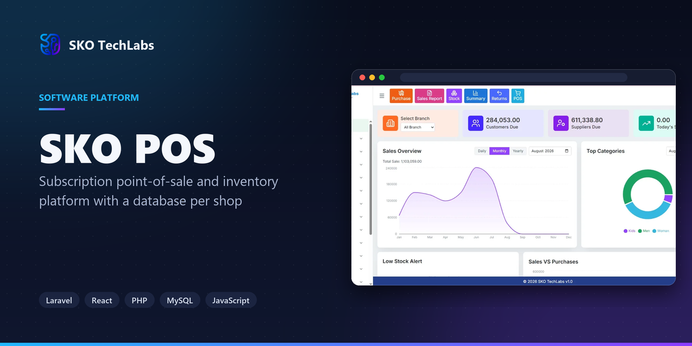
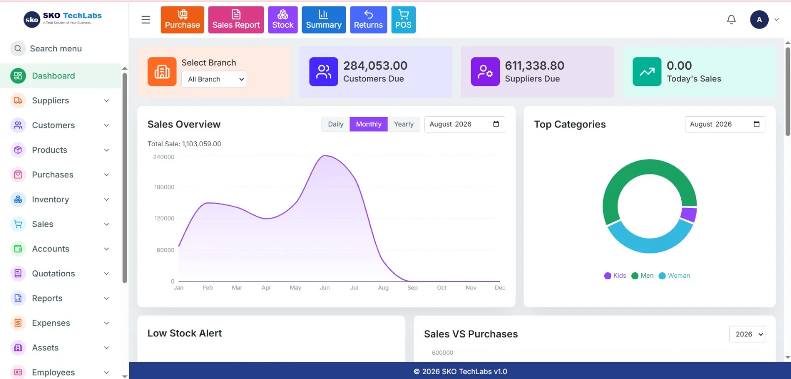

<h3>Subscription point-of-sale and inventory platform with a database per shop</h3>

A point-of-sale and inventory platform sold as a subscription. Every shop runs on its own database, so no query anywhere can return another shop’s rows.

   

<a href="https://pos1.skotechlabs.com"><b>Live Demo</b></a> &nbsp;·&nbsp; <a href="https://skotechlabs.com/projects/sko-techlabs-pos"><b>Case Study</b></a> &nbsp;·&nbsp; <a href="https://skotechlabs.com/contact"><b>Request a Demo</b></a> &nbsp;·&nbsp; <a href="https://github.com/skotechlabs"><b>All Products</b></a>

---

## Overview

A complete retail system built from scratch — selling, stock, purchasing, accounting and staff in one place. It is sold as a subscription: one deployment serves many shops, and each shop is given a database of its own rather than a tenant column on shared tables.

That choice costs something — a schema change has to run against every shop — and it buys the thing that matters most to a shop owner: their figures cannot leak into someone else’s report because of one forgotten condition in one query.

Every sale writes its own double-entry journal as it happens, so the accounts are never a separate reconciliation job at month end.

<table>
<tr>
<td width="50%" valign="top">

### The Challenge

A shop owner will not accept “your data is separated in software” as an answer. One shared database with a tenant column puts a data leak one forgotten WHERE clause away — across 45 reports of hand-written SQL, that is not a risk worth carrying.

</td>
<td width="50%" valign="top">

### Our Solution

Each shop is provisioned its own database, resolved from the subdomain on the way in. A small registry database holds only the list of shops, their plans and the operator logins. Nothing is shared, so there is no query that could cross a shop boundary even by mistake.

</td>
</tr>
</table>

## Key Features

- Point of sale with barcode scanning, held sales and exchanges
- Stock control with batch tracking and low-stock alerts
- Purchasing, suppliers and supplier ledgers
- Double-entry accounting posted automatically on every sale
- Customer accounts, dues, advances and instalments
- Quotations that convert to sales at the quoted price
- Staff, attendance and commission
- 45 reports covering sales, stock, accounts and parties
- Multi-branch, with figures filterable per branch

## Business Impact

- Adding a shop is one command and needs no code change
- Accounts are always current, because every sale posts its own journal
- A shop's data cannot appear in another shop's report by construction

## Screenshots

<table>
<tr>
<td width="50%" valign="top"> SKO POS: Subscription point-of-sale and inventory platform with a database per shop</td>
<td width="50%"></td>
</tr>
</table>

> See it running: **[pos1.skotechlabs.com](https://pos1.skotechlabs.com)**

## Technology Stack

## Source Code & Licensing

This repository is the public showcase for **SKO POS**. The production source code is proprietary and is maintained privately by SKO TechLabs.

Interested in this product for your business? We offer:

- **Ready-to-launch deployment** of SKO POS under your own brand and domain
- **Customisation** of features, workflows, languages and integrations to fit how you work
- **Custom development** of a new product built on the same foundations
- **Ongoing support**, hosting, maintenance and feature roll-outs after launch

## Get in Touch

---

© 2026 <a href="https://skotechlabs.com">SKO TechLabs</a> · Dhaka, Bangladesh · Building intelligent digital solutions

